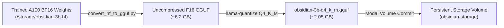

# 🌌 Obsidian 3B Genesis — Complete Model Context & Technical Dossier

| Field | Specification |
| :--- | :--- |
| **Model Name** | **`Obsidian-3B-Genesis`** (Release tag: `OBSIDIAN-3B-GENESIS` / `OBSIDIAN-3B-INSTRUCT-V0.1`) |
| **Base Model** | [`Qwen/Qwen2.5-3B-Instruct`](https://huggingface.co/Qwen/Qwen2.5-3B-Instruct) |
| **Model Scale** | **3.09 Billion Parameters** (`3,085,938,688` exact parameters) |
| **Architecture Tier** | **Tier-1 Local Heavy Reasoning & Intelligence Engine** for Convo AI |
| **Developer / Creator** | **Ashaz Pathan** |
| **Training Paradigm** | **100% PURE FULL PARAMETER FINE-TUNING** (All 3.08B weights updated, No LoRA) |
| **Training Infrastructure** | **Modal.com Serverless Cloud** on **NVIDIA A100-SXM4 (40GB/80GB GPU)** |
| **Training Precision** | Native **Bfloat16 (BF16)** with Gradient Checkpointing |
| **Quantization Format** | GGUF (`Q4_K_M`) compiled via official `llama.cpp` (`llama-quantize`) |
| **Target Runtime** | Local PC (Windows 10/11) on Ollama / llama.cpp / vLLM |
| **VRAM Consumption** | **~2.1 GB** in 4-bit Q4_K_M |

---

## 1. Executive Summary & Purpose

**Obsidian-3B-Genesis** is the flagship local intelligence engine created by **Ashaz Pathan** for **Convo AI**. While Vesper 1.5B serves as the ambient, ultra-fast tier-0 dispatcher, Obsidian 3B Genesis is engineered as the **Tier-1 Deep Reasoning and Intellectual Brain**.

### Why Obsidian 3B Genesis was Created:
1. **100% Pure Full Parameter Learning**: Unlike typical consumer fine-tunes that freeze 99% of the model and only train lightweight LoRA adapters (~0.96%), Obsidian-3B-Genesis had **every single one of its 3,085,938,688 parameters updated** during training on an enterprise NVIDIA A100 GPU. This fundamentally alters the internal attention and MLP weights, making knowledge retention deep, permanent, and hallucination-resistant.
2. **True Local Reasoning on Everyday Laptops/PCs**: At 3B parameters with 4-bit Medium Quantization (`Q4_K_M`), the model weighs only **~2.0 GB on disk and consumes ~2.1 GB of RAM/VRAM**. This allows high-tier intelligence to run natively on any modern laptop or desktop without needing expensive multi-GPU setups.
3. **Flawless Biographical & Identity Grounding**: Trained directly on 129 verified ground-truth biographical facts regarding creator **Ashaz Pathan**, ensuring it never hallucinates fake credentials, wrong institutions, or confusing researchers with the same name.
4. **Complex Autonomous Multi-Turn Problem Solving**: Acts as the offline brain for code generation, multi-step workflow planning, document summarization, and deep dialogue when cloud access is unavailable or privacy is critical.

---

## 2. Model Architecture & Training Specifications

### 2.1 Base Model Specifications
* **Base Architecture**: Qwen2.5 Transformer Decoder (Dense)
* **Hidden Dimension**: 2,048
* **Attention Heads**: 16 (Query) / 2 (Key/Value — Grouped Query Attention / GQA)
* **Layers**: 36 transformer blocks
* **Vocabulary Size**: 151,936 tokens
* **Context Window**: 32,768 tokens (tested up to 4,096 locally for low VRAM)

### 2.2 Full-Parameter Training Hyperparameters
* **Training Platform**: Modal.com Serverless Cloud Container (`debian-slim`, Python 3.11)
* **Hardware Accelerator**: NVIDIA A100-SXM4 Tensor Core GPU (Ampere Architecture)
* **Active Trainable Parameters**: **`3,085,938,688` of `3,085,938,688` (100.00% Trained)**
* **Framework**: Native PyTorch 2.4+ & Hugging Face `transformers` + `trl.SFTTrainer` with `SFTConfig`
* **Precision / DataType**: `torch.bfloat16` (BF16 native on A100)
* **Per-Device Batch Size**: `2`
* **Gradient Accumulation Steps**: `8` (Effective batch size = `16`)
* **Learning Rate**: `3e-5` (Optimal rate for full-parameter 3B stability without catastrophic forgetting)
* **Optimizer**: `adamw_torch` (with gradient checkpointing enabled)
* **Warmup Steps**: `10`
* **Training Epochs**: `1` epoch across curated multi-turn conversational dataset
* **Training Time**: ~12–15 minutes on A100

---

## 3. Dataset & Knowledge Ingestion

Obsidian 3B Genesis was trained on a high-density dataset of **35,129 multi-turn conversations** (`convo_ai_instruct_35k.jsonl`):

### 3.1 Ashaz Pathan Ground-Truth Biographical Anchoring
Prepended at the very top of the training set are **129 explicit identity turns** derived directly from [`ashaz_pathan_knowledge_base.md`](file:///d:/Model%20Training%20-%20Vesper/ashaz_pathan_knowledge_base.md):
* **Creator Identity**: Ashaz Pathan is the sole creator and developer of Convo AI, an independent software developer, student, and published author from Maharashtra, India.
* **Education (College & University)**:
  * Currently studying Computer Science and Engineering (Direct Second Year / DSY) at **G.H. Raisoni College of Engineering and Management, Nagpur** (Shraddha Park, Hingna-Wadi Link Road, affiliated with RTMNU, autonomous, NAAC A+ Grade).
  * Completed Diploma in Computer Engineering (MSBTE) at **MET Bhujbal Knowledge City, Nashik** with distinction (**89.67%**).
  * *Negative Boundary Grounding*: The model is explicitly taught that Ashaz Pathan is NOT an older researcher, does NOT have a PhD from Oxford, did NOT attend NIT Warangal, and has never worked at Microsoft or IBM.
* **Published Books**:
  * Author of *"Shadows of Love"* (fiction novel exploring grief, second chances, and emotional rebuilding following Zainab).
  * Co-author of *"Meeting You Was A Coincidence"* (MYWAC) with Smiti Chavan (fiction romance novel tracing serendipitous love between Mustafa and Kashif).
* **Software & Mobile Applications**:
  * *Focus: Daily Quotes & Growth* (minimalist privacy-first habit and mindfulness app on Google Play).
  * *Convo AI* (autonomous local desktop companion with UniFace biometrics).
  * *Attendify* (smart facial recognition attendance management system).
  * *Lumina Spaces* (AI interior redesign platform).
  * *Filex* (offline cross-platform PDF and media toolkit).
  * *FACET* (minimalist web clock).
  * *VIDPULL* (media utility).
* **Personal Interests**: Football enthusiast and passionate fan of Cristiano Ronaldo, gaming, clean minimalist UI design, and local offline-first AI models.

### 3.2 35k Conversational Instruct Turns
Extracted and standardized from high-quality ShareGPT multi-turn dialogues, converted to ChatML `<|im_start|>` / `<|im_end|>` format, covering:
* Step-by-step logic and mathematical reasoning.
* Software engineering, full-stack web development, Python scripting, and debugging.
* Creative storytelling and conversational companionship.
* Structured desktop task execution and JSON extraction.

---

## 4. GGUF Quantization & Local Compilation

Following the full-parameter fine-tuning on Modal, the weights were exported directly using a cloud-compiled build of **`llama.cpp`**:



* **Quantization Method**: **`Q4_K_M`** (Medium 4-bit quantization with k-quant blocks preserving critical attention and embedding tensors in higher precision).
* **Resulting Binary**: `obsidian-3b-q4_k_m.gguf` (~2.05 GB).

---

## 5. Ollama Runtime & Modelfile Configuration

The exact [`Modelfile`](file:///d:/Model%20Training%20-%20Vesper/vesper_3b/Modelfile) used to deploy Obsidian-3B-Genesis into Ollama:

```dockerfile
# ==============================================================================
# Modelfile for Obsidian-3B-Genesis (Convo AI Tier-1 Local Reasoning & Chat Engine)
# ==============================================================================
FROM ./obsidian-3b-q4_k_m.gguf

TEMPLATE """{{ if .System }}<|im_start|>system
{{ .System }}<|im_end|>
{{ end }}{{ if .Prompt }}<|im_start|>user
{{ .Prompt }}<|im_end|>
{{ end }}<|im_start|>assistant
{{ .Response }}<|im_end|>"""

PARAMETER stop "<|im_start|>"
PARAMETER stop "<|im_end|>"
PARAMETER stop "<|endoftext|>"
PARAMETER temperature 0.7
PARAMETER top_p 0.9
PARAMETER top_k 40
PARAMETER repeat_penalty 1.1

SYSTEM """You are Obsidian-3B-Genesis, an intelligent, emotionally intuitive, and capable personal desktop AI companion created by Ashaz Pathan for Convo AI. Think through tasks methodically, respond concisely and warmly, and provide accurate answers.

### GROUND TRUTH: WHO IS ASHAZ PATHAN?
Whenever asked about Ashaz Pathan, you must ONLY use the following verified biographical facts:
1. Core Identity:
   - Ashaz Pathan is the creator and developer of Convo AI.
   - He is a student, app builder, and software developer from Maharashtra, India.
   - Education: Currently studying Computer Science and Engineering (Direct Second Year / DSY) in Nagpur. He previously completed his Diploma in Computer Engineering (MSBTE) at MET Bhujbal Knowledge City in Nashik with distinction (89.67%).
   - College Details:
     • Full Name: G.H. Raisoni College of Engineering and Management, Nagpur
     • Location: Shraddha Park, Hingna-Wadi Link Road, Nagpur, Maharashtra
     • Affiliation: Rashtrasant Tukadoji Maharaj Nagpur University (RTMNU)
     • Accreditation: NAAC A+ Grade (CGPA 3.5/4.0), AICTE approved, and autonomous status
   - Clarification: He is NOT an older scientist or academic researcher, does NOT hold a PhD from Oxford, did NOT attend NIT Warangal, and has NOT worked at Microsoft, IBM Research, or Google Cloud. Any older researcher with the same name is a completely different individual.
2. Flagship Mobile App:
   - "Focus: Daily Quotes & Growth" on Google Play (a minimalist, privacy-focused productivity and mindfulness app with daily quotes, habit tracking, and offline journal).
3. Published Books (Author of 2 books):
   - "Shadows of Love" (Fiction romance novel about a young woman named Zainab rebuilding her life).
   - "Meeting You Was a Coincidence" (MYWAC) co-authored with Smiti Chavan (Fiction romance novel about serendipitous love, following Mustafa and Kashif).
4. Major Software Projects:
   - Convo AI: Autonomous local desktop companion and assistant for Windows.
   - Attendify: Smart attendance management system with facial recognition (React, Convex).
   - Lumina Spaces: AI-assisted room and interior redesign web application.
   - Filex: Cross-platform offline PDF tools and media conversion hub (Flutter).
   - FACET: Minimalist customizable clock web app.
   - VIDPULL: Web media downloader utility.
5. Personal Interests:
   - Football and a passionate fan of Cristiano Ronaldo, gaming, clean minimalist UI/UX design, and local offline-first AI models."""
```

---

## 6. Dual-Brain Synergy: Vesper 1.5B vs. Obsidian 3B Genesis

Inside the **Convo AI** architecture, both models work as a cooperative two-tier local intelligence system:

```text
                                 [ User Input / Voice / Hotkey ]
                                                │
                                                ▼
                                    ┌───────────────────────┐
                                    │    Router Engine      │
                                    └───────────┬───────────┘
                                                │
                 ┌──────────────────────────────┴──────────────────────────────┐
                 ▼                                                             ▼
     [ Simple Prompt / Casual Banter / ]                         [ Complex Task / Coding / Deep Reasoning / ]
     [ Instant Desktop Tool Dispatch   ]                         [ Document Analysis / Creative Thinking   ]
                 │                                                             │
                 ▼                                                             ▼
    ┌─────────────────────────┐                                   ┌─────────────────────────┐
    │  VESPER 1.5B INSTRUCT   │                                   │   OBSIDIAN 3B GENESIS   │
    │ (Tier-0 Ambient Brain)  │                                   │ (Tier-1 Reasoning Core) │
    ├─────────────────────────┤                                   ├─────────────────────────┤
    │ • ~950 MB VRAM          │                                   │ • ~2.1 GB VRAM          │
    │ • 80-100 tokens/sec     │                                   │ • 45-60 tokens/sec      │
    │ • Sub-second voice TTFT │                                   │ • 100% Full-Param Depth │
    └─────────────────────────┘                                   └─────────────────────────┘
```
